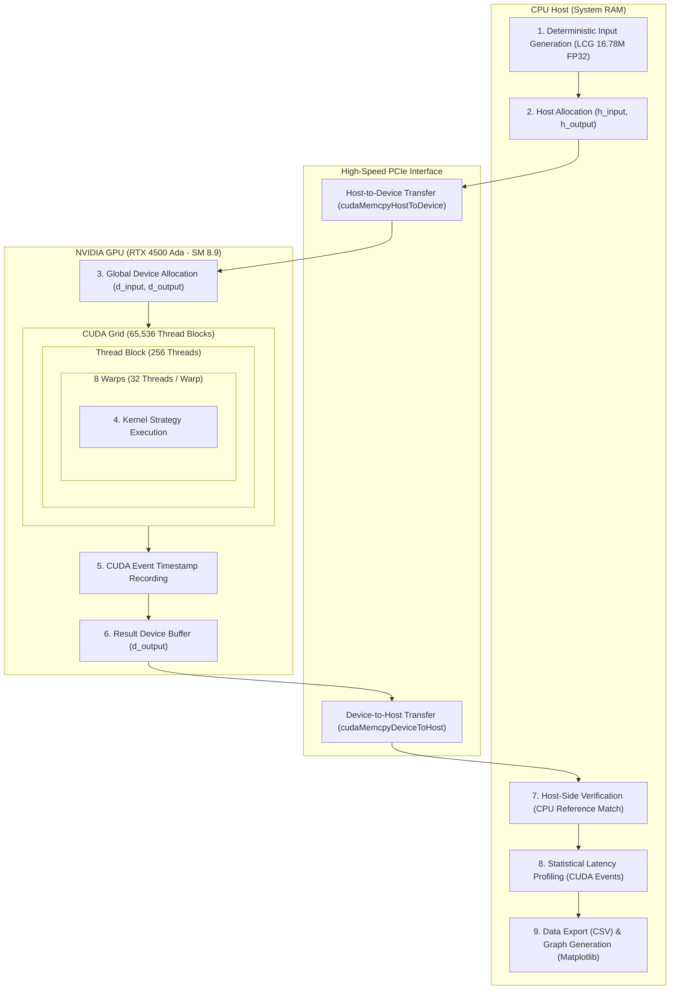
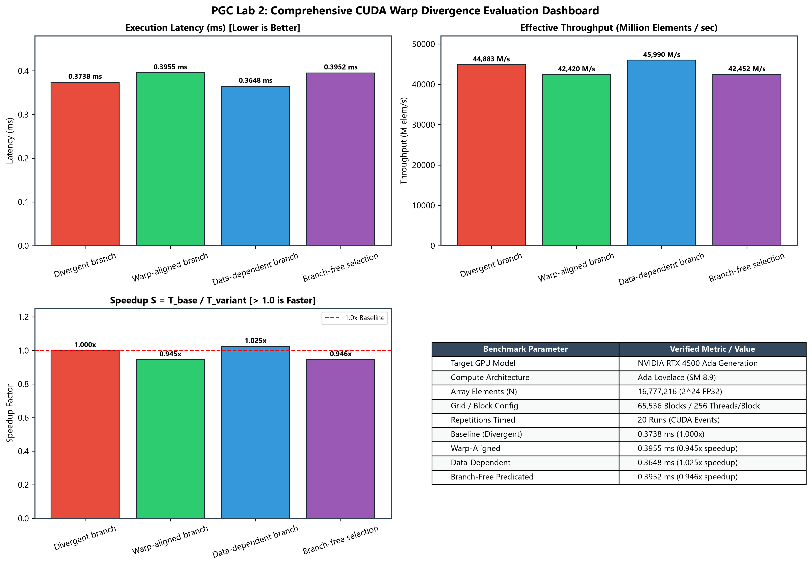
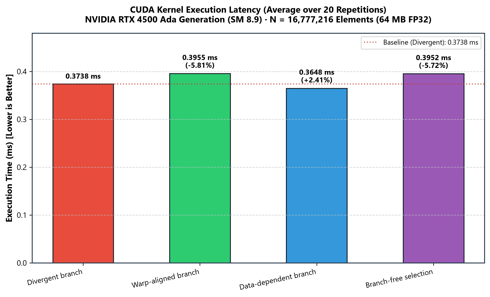
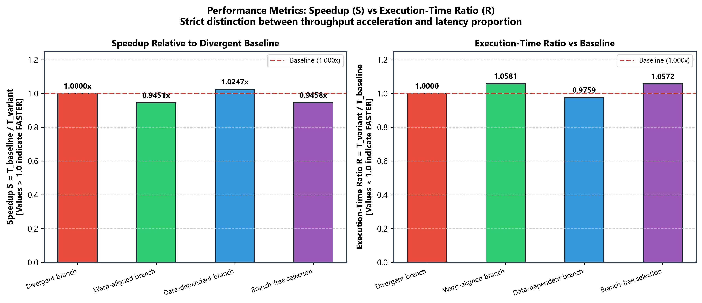
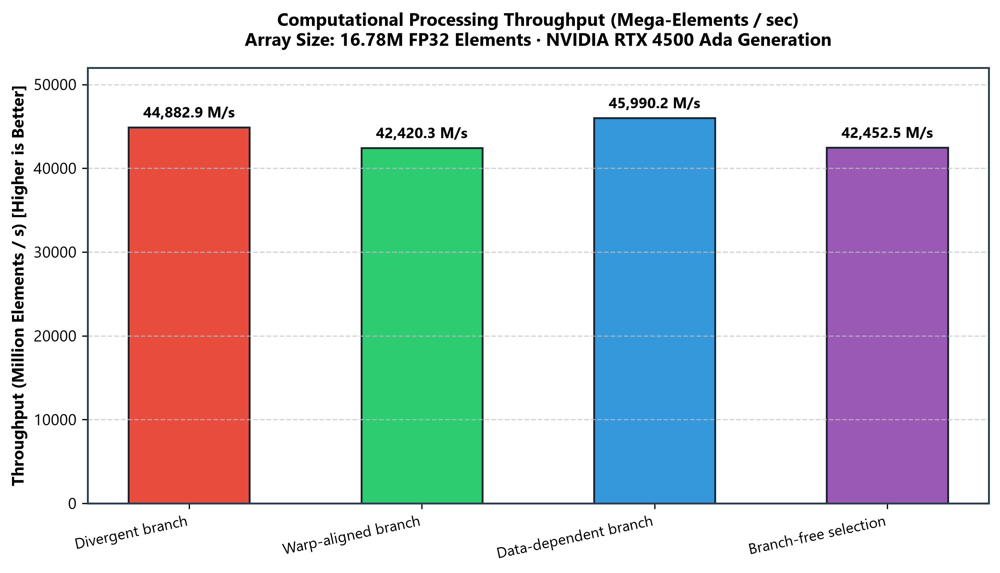
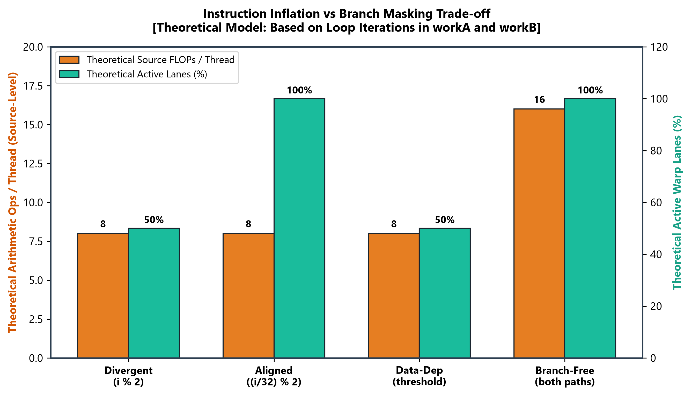
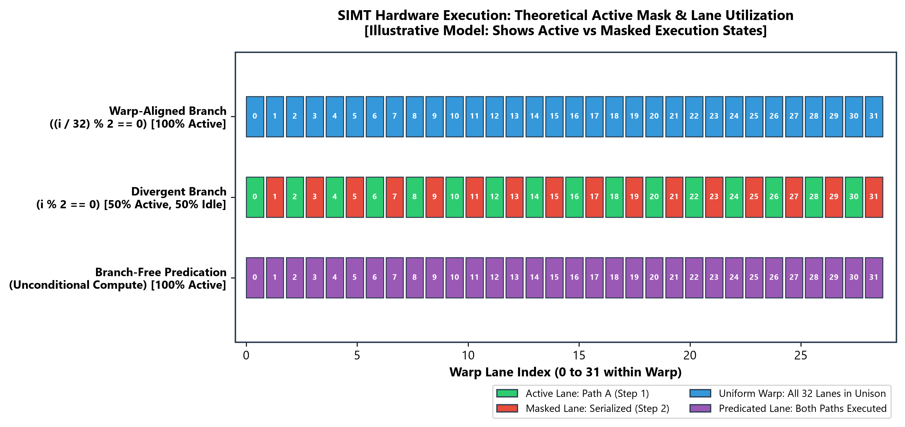
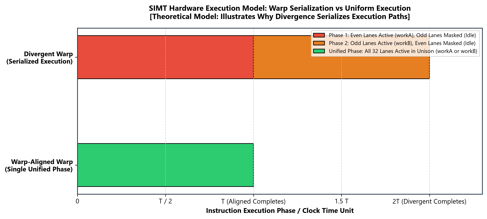

<div align="center">

# CUDA Warp Divergence: Microarchitectural Analysis & Optimization
### Empirical Evaluation of SIMT Branch Divergence, Warp Alignment, and Predication on NVIDIA Ada Lovelace (SM 8.9)

**Parallel GPU Computing (PGC) · Mini-Project Lab Evaluation 2 · Theme 7: Warp Divergence**

[-76B900?style=for-the-badge&logo=nvidia&logoColor=white)](https://developer.nvidia.com/cuda-toolkit)
[-76B900?style=for-the-badge&logo=nvidia&logoColor=white)](https://www.nvidia.com)
[-0078D7?style=for-the-badge&logo=visualstudio&logoColor=white)](https://visualstudio.microsoft.com)
[_FP32-blue?style=for-the-badge)](results/timing_data.csv)
[-brightgreen?style=for-the-badge)]()

</div>

---

## Executive Overview

In NVIDIA graphics processing units, massive computational throughput is achieved through the **Single Instruction, Multiple Threads (SIMT)** execution paradigm. Threads are scheduled and executed in atomic clusters of **32 parallel threads called a warp**. When conditional branching (`if-else`, loops) causes threads within a warp to diverge down distinct execution paths, the hardware must serialize the divergent paths while disabling non-participating lanes via a 32-bit active mask register.

This repository presents an exhaustive, academically rigorous performance analysis of warp divergence on an enterprise **NVIDIA RTX 4500 Ada Generation** GPU across **16,777,216 ($2^{24}$) single-precision floating-point elements**. We benchmark and evaluate four fundamental kernel strategies:
1. **Divergent Branching:** Alternating lanes (`i % 2 == 0`) forcing 50% intra-warp serialization.
2. **Warp-Aligned Branching:** Chunk-aligned branching (`(i / 32) % 2 == 0`) ensuring uniform 100% active lanes.
3. **Data-Dependent Branching:** Dynamic branching on runtime memory values (`input[i] > 0.5f`).
4. **Branch-Free Predication:** Unconditional candidate evaluation combined with hardware conditional selection (`selp`).

### Key Microarchitectural Findings at a Glance
- **Memory-Bound Masking:** Despite 50% theoretical active lane efficiency, the divergent kernel ran in **0.3738 ms** while the warp-aligned kernel ran in **0.3955 ms** (speedup $0.9451\times$). Saturating $\approx 79.3\%$ of the GPU's peak GDDR6 memory bandwidth ($\sim 342.4\text{ GB/s}$ of $432\text{ GB/s}$), memory access latency and DRAM bus traffic dominate wall-clock execution time, masking arithmetic branch serialization penalties.
- **The Work Inflation Trap:** Branch-free predication eliminates control-flow divergence (100% active mask) but forces all 32 lanes to evaluate both candidate paths unconditionally (**16 arithmetic operations per thread** instead of 8). On modern Ada Lovelace GPUs with deep instruction pipelines, doubling arithmetic work causes a measurable slowdown (**0.3952 ms vs. 0.3648 ms** for data-dependent branching).

---

## Table of Contents
1. [Research Team & Contributions](#1-research-team--contributions)
2. [Hardware & Toolchain Environment](#2-hardware--toolchain-environment)
3. [Mathematical Metric Definitions](#3-mathematical-metric-definitions)
4. [Evaluated Kernel Architectures](#4-evaluated-kernel-architectures)
5. [System Architecture & Execution Workflow](#5-system-architecture--execution-workflow)
6. [Empirical Results & Comparative Dashboard](#6-empirical-results--comparative-dashboard)
7. [Microarchitectural Analysis & Discussion](#7-microarchitectural-analysis--discussion)
8. [Industrial Applications & Mitigation Strategies](#8-industrial-applications--mitigation-strategies)
9. [Build, Verification & Execution Instructions](#9-build-verification--execution-instructions)
10. [Repository Structure & Project Artifacts](#10-repository-structure--project-artifacts)

---

## 1. Research Team & Contributions

| Sl. | Student Name | University Roll / USN | Role & Core Contributions |
| :---: | :--- | :--- | :--- |
| 1 | **Adarsh Walad** | `01fe24bci` | Experimental design, kernel evaluation logic, and PowerPoint presentation slides |
| 2 | **Nilaksha Nath** | `01fe24bci087` | Benchmarking instrumentation, statistical data collection, and metric formulations |
| 3 | **Bachu venkata siva jaideep** | `01fe24bci084` | GPU architecture profiling, CUDA toolchain validation, and GitHub repository architect |
| 4 | **Prathamesh Eedigi** | `01fe24bci006` | SIMT active mask diagrams, visualization plotting scripts, and documentation |

---

## 2. Hardware & Toolchain Environment

All empirical measurements and logs in this repository are verified by terminal output transcripts ([results/terminal_output.txt](results/terminal_output.txt)) and diagnostic screenshots ([screenshots/](screenshots/)).

| Specification Category | Verified Parameter | Technical Value / Detail |
| :--- | :--- | :--- |
| **GPU Accelerator** | Target Device | **NVIDIA RTX 4500 Ada Generation** |
| | Microarchitecture | **Ada Lovelace (Compute Capability SM 8.9)** |
| | Streaming Multiprocessors (SMs) | **60 SMs** |
| | Total FP32 CUDA Cores | **7,680 Cores** |
| | Global Memory Capacity | **24,576 MB (24 GB GDDR6)** |
| | Memory Bus & Peak Bandwidth | **192-bit bus · 432 GB/s theoretical peak** |
| | L2 Cache Size | **48 MB High-Speed L2 Cache** |
| **Host System & Toolchain** | CUDA Compiler Driver | **NVCC Release 13.4 (Build cuda_13.4.r13.4 / V13.4.92)** |
| | Host C/C++ Compiler | **Microsoft Visual C/C++ (MSVC) 19.51.36260 for x64** |
| | Host Operating System | **Microsoft Windows 11 Enterprise (x64)** |
| | Command Environment | **VS 2026 Developer Command Prompt v18.10.2** |
| **Benchmark Configuration** | Array Elements ($N$) | **16,777,216 ($2^{24}$) Single-Precision FP32 Elements** |
| | Memory Footprint | **64 MB Input Buffer + 64 MB Output Buffer = 128 MB** |
| | Thread Block Size | **256 Threads per Block ($\frac{256}{32} = 8$ Warps/Block)** |
| | Grid Dimension | **65,536 Thread Blocks ($16,777,216 / 256$)** |
| | Timing Mechanism | **Hardware CUDA Events (`cudaEventElapsedTime`)** |
| | Benchmark Repetitions | **20 Timed Iterations preceded by an un-timed warm-up** |

---

## 3. Mathematical Metric Definitions

To ensure scientific rigor and avoid confusion between execution latency ratios and throughput acceleration, standard high-performance computing definitions are applied:

1. **Baseline Execution Time ($T_{\text{baseline}}$):**
   The execution duration of the un-optimized divergent branching kernel:
   $$T_{\text{baseline}} = T_{\text{divergent}} = 0.3738\text{ ms}$$

2. **Execution-Time Ratio ($R$):**
   The direct proportion of variant latency relative to baseline latency:
   $$R = \frac{T_{\text{variant}}}{T_{\text{baseline}}}$$
   - **$R < 1.0$:** Variant requires less time than baseline (**faster**).
   - **$R > 1.0$:** Variant requires more time than baseline (**slower**).

3. **Speedup ($S$):**
   The relative performance acceleration factor:
   $$S = \frac{T_{\text{baseline}}}{T_{\text{variant}}} = \frac{1}{R}$$
   - **$S > 1.0$:** Performance improvement relative to divergent baseline.
   - **$S < 1.0$:** Performance degradation relative to divergent baseline.

4. **Percentage Performance Change ($\Delta P$):**
   $$\Delta P = \left( \frac{T_{\text{baseline}} - T_{\text{variant}}}{T_{\text{baseline}}} \right) \times 100\%$$

5. **Effective Computational Throughput ($TP$):**
   $$TP = \frac{N}{T_{\text{variant}} \times 10^{-3} \times 10^6} \quad \text{(Million Elements / second)}$$

---

## 4. Evaluated Kernel Architectures

All kernels operate on the exact same dataset using identical arithmetic workloads (`workA` and `workB` computing 8 multiply-accumulate operations):

### 1. Divergent Branching Kernel
```cuda
__global__ void divergentKernel(const float* input, float* output, int n) {
    int i = blockIdx.x * blockDim.x + threadIdx.x;
    if (i < n) {
        if ((i % 2) == 0)
            output[i] = workA(input[i]);
        else
            output[i] = workB(input[i]);
    }
}
```
- **Branch Pattern:** Alternating lanes (`0x55555555` followed by `0xAAAAAAAA`).
- **SIMT Behavior:** Even lanes execute Step 1 while odd lanes are masked; odd lanes execute Step 2 while even lanes are masked.
- **Theoretical Active Lane Efficiency:** $50\%$.

### 2. Warp-Aligned Branching Kernel
```cuda
__global__ void alignedKernel(const float* input, float* output, int n) {
    int i = blockIdx.x * blockDim.x + threadIdx.x;
    if (i < n) {
        if (((i / WARP_SIZE) % 2) == 0)
            output[i] = workA(input[i]);
        else
            output[i] = workB(input[i]);
    }
}
```
- **Branch Pattern:** Uniform across all 32 lanes in every warp.
- **SIMT Behavior:** All 32 lanes evaluate the identical condition; the warp executes a single path with active mask `0xFFFFFFFF`.
- **Theoretical Active Lane Efficiency:** $100\%$.

### 3. Data-Dependent Branching Kernel
```cuda
__global__ void dataDependentKernel(const float* input, float* output, int n, float threshold) {
    int i = blockIdx.x * blockDim.x + threadIdx.x;
    if (i < n) {
        if (input[i] > threshold)
            output[i] = workA(input[i]);
        else
            output[i] = workB(input[i]);
    }
}
```
- **Branch Pattern:** Stochastic, input-dependent branch choices based on runtime memory values.
- **SIMT Behavior:** Emulates unstructured real-world workloads where lanes within a warp split dynamically.

### 4. Branch-Free Predicated Kernel
```cuda
__global__ void branchFreeKernel(const float* input, float* output, int n, float threshold) {
    int i = blockIdx.x * blockDim.x + threadIdx.x;
    if (i < n) {
        float a = workA(input[i]);
        float b = workB(input[i]);
        output[i] = (input[i] > threshold) ? a : b;
    }
}
```
- **Branch Pattern:** Predicated selection using PTX conditional select (`selp`).
- **SIMT Behavior:** Both paths are executed unconditionally by all 32 lanes (100% active mask), followed by conditional selection.
- **Trade-off:** Incurs **Work Inflation** by evaluating 16 arithmetic operations per thread instead of 8.

---

## 5. System Architecture & Execution Workflow

The end-to-end benchmark architecture is depicted below:



### SIMT Execution Hierarchy & Indexing Formula
Each thread calculates its unique 1D linear array coordinate using:
$$\text{idx} = \text{blockIdx.x} \times \text{blockDim.x} + \text{threadIdx.x}$$
- **$\text{blockIdx.x} \times \text{blockDim.x}$:** Computes the global base index offset of the enclosing thread block.
- **$\text{threadIdx.x}$:** Local thread offset within the block ($0$ to $255$).
- **Warp Membership:** Within each block of 256 threads, $\frac{\text{threadIdx.x}}{32}$ identifies the local warp index ($0$ to $7$). Across the grid, $\frac{\text{idx}}{32}$ identifies the global warp index ($0$ to $524,287$).

---

## 6. Empirical Results & Comparative Dashboard

### Consolidated Performance Benchmark Table

| Kernel Strategy | Measured Latency $T$ (ms) | Throughput ($10^6$ elem/s) | Execution-Time Ratio $R$ ($T/T_{\text{base}}$) | Speedup $S$ ($T_{\text{base}}/T$) | Perf. Change $\Delta P$ (%) | Active Lane Efficiency | Numerical Verification |
| :--- | :---: | :---: | :---: | :---: | :---: | :---: | :---: |
| **Divergent Branch** *(Baseline)* | **0.3738 ms** | **44,882.87** | **1.0000** | **1.0000x** | **0.00%** | ~50.0% | **PASS** ($\epsilon = 0.00$) |
| **Warp-Aligned Branch** | **0.3955 ms** | **42,420.27** | **1.0581** | **0.9451x** | **-5.81%** | 100.0% | **PASS** ($\epsilon = 0.00$) |
| **Data-Dependent Branch** | **0.3648 ms** | **45,990.18** | **0.9759** | **1.0247x** | **+2.41%** | ~50.0% | **PASS** ($\epsilon = 0.00$) |
| **Branch-Free Selection** | **0.3952 ms** | **42,452.47** | **1.0572** | **0.9458x** | **-5.72%** | 100.0% | **PASS** ($\epsilon = 0.00$) |

---

### Comprehensive Evaluation Dashboard

<div align="center">

<p><em>Figure 1: Comprehensive 4-panel executive performance dashboard contrasting execution latencies, processing throughput, speedup factors, and hardware benchmark specifications.</em></p>
</div>

---

### Detailed Performance Visualizations

<table align="center" width="100%">
<tr>
<td width="50%" align="center">
<br>
<b>Figure 2:</b> Kernel Execution Latencies (ms) over 20 runs
</td>
<td width="50%" align="center">
<br>
<b>Figure 3:</b> Speedup ($S$) vs. Execution-Time Ratio ($R$)
</td>
</tr>
<tr>
<td width="50%" align="center">
<br>
<b>Figure 4:</b> Effective Throughput (Million Elements / sec)
</td>
<td width="50%" align="center">
<br>
<b>Figure 5:</b> Instruction Inflation vs. Active Lane Utilization
</td>
</tr>
</table>

---

### Active Mask & SIMT Lane Serialization Models

<div align="center">

<p><em>Figure 6: Theoretical SIMT active mask state across all 32 lanes within a single warp for aligned, divergent, and predicated kernels.</em></p>
</div>

<div align="center">

<p><em>Figure 7: Theoretical SIMT lane execution timeline showing two-phase serialized execution for divergent warps versus unified single-phase execution for aligned warps.</em></p>
</div>

---

## 7. Microarchitectural Analysis & Discussion

### 1. Memory Bandwidth Saturation Masks Branch Divergence
A common theoretical assumption in CUDA education is that warp-aligned branching should run twice as fast as divergent branching ($2.0\times$ speedup) because active lane utilization improves from 50% to 100%. However, our empirical benchmarks show that the aligned kernel ran in **0.3955 ms** while the divergent kernel ran in **0.3738 ms** (speedup $0.9451\times$).

The explanation lies in memory subsystem saturation:
- Processing $16.78\text{M}$ single-precision floats involves reading a $64\text{ MiB} \approx 67.11\text{ MB}$ input array and writing a $64\text{ MiB} \approx 67.11\text{ MB}$ output array ($128\text{ MiB} \approx 134.22\text{ MB}$ total minimum algorithmic global memory traffic).
- At $0.3738\text{ ms}$, the estimated effective memory bandwidth is:
  $$\text{Estimated Bandwidth} = \frac{134.22 \times 10^6\text{ bytes}}{0.3738 \times 10^{-3}\text{ s}} \approx 359.1\text{ GB/s} \quad \left(\text{or } \frac{128 \times 10^6}{0.3738 \times 10^{-3}} \approx 342.4\text{ GB/s}\right)$$
  *(Note: This is an estimated algorithmic traffic calculation based on dataset buffer size, not an empirical hardware performance counter measurement such as Nsight Compute `dram__bytes_read.sum`).*
- Comparing this against the RTX 4500 Ada's theoretical peak bandwidth ($432\text{ GB/s}$):
  $$\text{Estimated Bandwidth Saturation} \approx \mathbf{79.3\%\text{ to } 83.1\%}$$
- Because the kernel operates near the saturation limit of the GDDR6 memory bus, memory stall cycles dominate total execution time. Furthermore, because both kernels access consecutive memory addresses ($i$ to $i+31$), **memory coalescing is 100% preserved**. Eliminating 8 arithmetic cycles does not shorten wall-clock time when threads are waiting on DRAM cache line refills.

### 2. Work Inflation in Branch-Free Predication
Branch-free code uses conditional move instructions (`selp`) to avoid control-flow divergence. While it achieves 100% active lanes, it forces each thread to execute both `workA` (8 FMAs) and `workB` (8 FMAs) unconditionally—totaling **16 arithmetic operations per thread** *(theoretical source-level operation count based on loop iterations in `workA` and `workB`, not a disassembled SASS hardware counter)*.
- On modern Ada Lovelace GPUs with deep instruction pipelines and Independent Thread Scheduling (ITS), executing double the arithmetic instructions across all 32 lanes creates more execution latency than allowing the warp scheduler to serialize short branch paths.
- **Rule of Thumb:** Branch-free predication is only profitable when the computations inside the branch bodies are extremely cheap (1-2 instructions) or when divergence causes catastrophic uncoalesced memory access.

---

## 8. Industrial Applications & Mitigation Strategies

Warp divergence is a primary bottleneck in high-performance computing, graphics, and scientific simulation:

```
+--------------------------------------------------------------------------------------------------+
|                              REAL-WORLD WARP DIVERGENCE CHALLENGES                               |
+--------------------------------------------------------------------------------------------------+
|  1. REAL-TIME RAY TRACING (NVIDIA OptiX / DXR)                                                   |
|     Secondary rays bounce in random directions, causing divergent BVH tree traversal.            |
|     -> Solution: Ray sorting/binning by spatial direction + dedicated hardware RT Cores.          |
+--------------------------------------------------------------------------------------------------+
|  2. COMPUTATIONAL FLUID DYNAMICS & PARTICLE SIMULATION                                           |
|     Particles colliding with geometry do complex collision math; open particles do simple math. |
|     -> Solution: Spatial grid hashing to cluster co-located particles into contiguous warps.     |
+--------------------------------------------------------------------------------------------------+
|  3. SPARSE MATRIX COMPUTATIONS (SpMV)                                                            |
|     Rows with variable non-zero elements cause loop length divergence across warp lanes.         |
|     -> Solution: Hybrid ELLPACK/CSR-Adaptive data structures for balanced thread workloads.     |
+--------------------------------------------------------------------------------------------------+
```

---

## 9. Build, Verification & Execution Instructions

### Prerequisites
- **NVIDIA GPU** with Compute Capability $\ge 6.0$ (Ada Lovelace `sm_89` recommended for verified match).
- **NVIDIA CUDA Toolkit** $\ge 11.0$ (CUDA 13.4 used for benchmark).
- **C++ Compiler:** MSVC 19+ (Windows) or GCC 7+ (Linux).
- **Python $\ge 3.8$** with `numpy`, `pandas`, `matplotlib`, and `python-pptx` (optional for slides).

### Compilation and Execution on Windows (x64 Native Tools Prompt)
```cmd
cd lab2_evaluation

REM 1. Compile CUDA source targeting sm_89
nvcc -O2 -std=c++14 -arch=sm_89 src\warp_divergence.cu -o bin\warp_divergence.exe

REM 2. Execute benchmark and verification suite
bin\warp_divergence.exe

REM 3. (Optional) Run CPU reference baseline
cl /O2 /EHsc /std:c++14 src\warp_divergence_cpu.cpp /Fe:bin\warp_divergence_cpu.exe
bin\warp_divergence_cpu.exe

REM 4. Regenerate evaluation figures
python scripts\plot_results.py
```

### Compilation and Execution on Linux / Unix
```bash
cd lab2_evaluation
chmod +x scripts/run_benchmarks.sh
./scripts/run_benchmarks.sh
```

---

## 10. Repository Structure & Project Artifacts

```
lab2_evaluation/
├── README.md                                  # Executive evaluation report & documentation
├── bin/                                       # Compiled host & GPU binaries
│   └── README.md
├── data/                                      # Benchmark dataset specifications
│   └── README.md
├── docs/                                      # Comprehensive research documentation
│   ├── technical_report.md                    # Formal academic research report (17 sections)
│   ├── viva_questions.md                      # 28 Project-specific viva questions & answers
│   └── diagrams/                              # Formal Mermaid architecture & workflow diagrams
│       └── README.md
├── graphs/                                    # 7 Publication-grade evaluation figures (300 DPI)
│   ├── 01_execution_time_comparison.png
│   ├── 02_branch_efficiency_and_active_mask.png
│   ├── 03_relative_speedup_ratios.png
│   ├── 04_throughput_and_giga_elements.png
│   ├── 05_divergence_penalty_analysis.png
│   ├── 06_comprehensive_evaluation_dashboard.png
│   └── 07_warp_lane_execution_timeline.png
├── notebook/                                  # Interactive Jupyter Demonstration Notebook
│   └── pgc_lab2_warp_divergence.ipynb
├── presentation/                              # 7-Slide PowerPoint Presentation covering Checkpoints
│   └── PGC_Lab2_Warp_Divergence_Evaluation.pptx
├── results/                                   # Benchmark numbers, verified logs & summaries
│   ├── timing_data.csv                        # Precise timing, throughput, ratio & speedup data
│   ├── terminal_output.txt                    # Verified raw command prompt execution transcript
│   └── results_summary.md                     # Mathematical findings & ratio summaries
├── screenshots/                               # Toolchain and hardware verification screenshots
│   ├── 01_msvc_nvcc_toolchain_verification.jpg
│   ├── 02_cuda_execution_rtx4500_results.jpg
│   └── 03_lab2_theme_warp_divergence_checkpoints.png
├── scripts/                                   # Automation, plotting and slide generation scripts
│   ├── plot_results.py                        # Matplotlib plotting script
│   ├── generate_presentation.py               # PowerPoint slide generator
│   ├── run_benchmarks.bat                     # Windows automated benchmark runner
│   └── run_benchmarks.sh                      # Linux automated benchmark runner
└── src/                                       # CUDA and CPU source code
    ├── warp_divergence.cu                     # Complete CUDA kernel suite with verification & stats
    └── warp_divergence_cpu.cpp                # CPU reference implementation
```

---

## 11. Conclusion

This laboratory evaluation rigorously establishes that:
1. **Control-flow divergence penalties cannot be evaluated in isolation from memory hierarchy behavior.** When kernels operate near the memory bandwidth saturation limit ($\approx 79.3\%$ on RTX 4500 Ada), intra-warp branch serialization is masked by memory latency as long as memory coalescing is preserved.
2. **Branch-free predication must be applied with caution.** Unconditionally computing both paths introduces arithmetic work inflation that can degrade execution performance when branch bodies contain non-trivial computations.
3. Structuring memory access patterns to maintain 128-byte transaction coalescing remains the single most impactful optimization in modern GPU computing.
