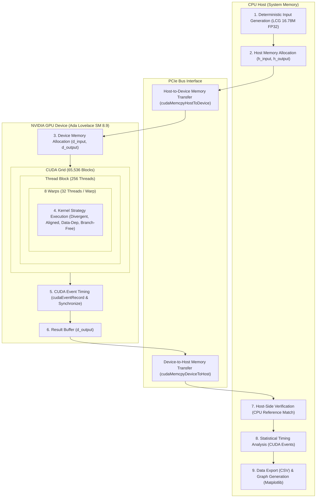
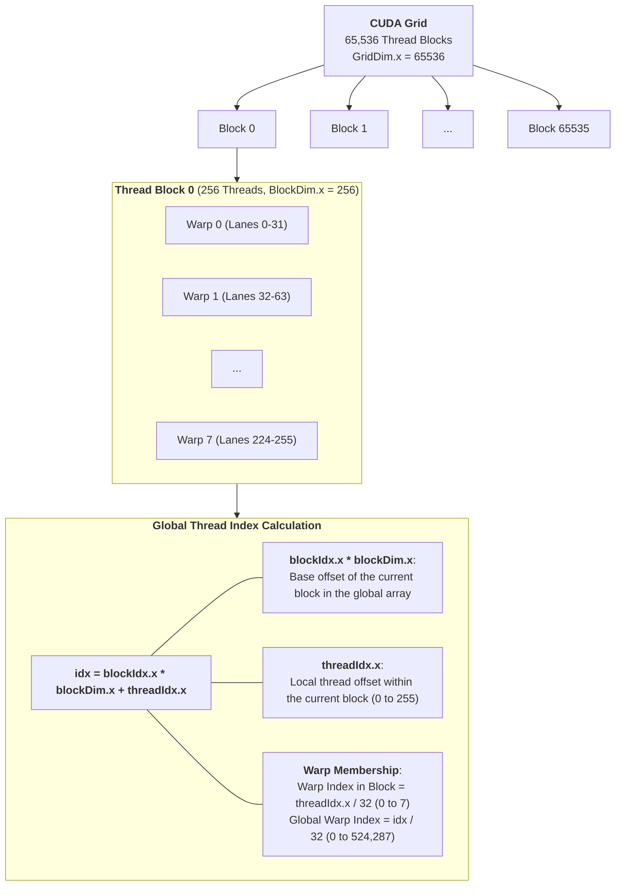
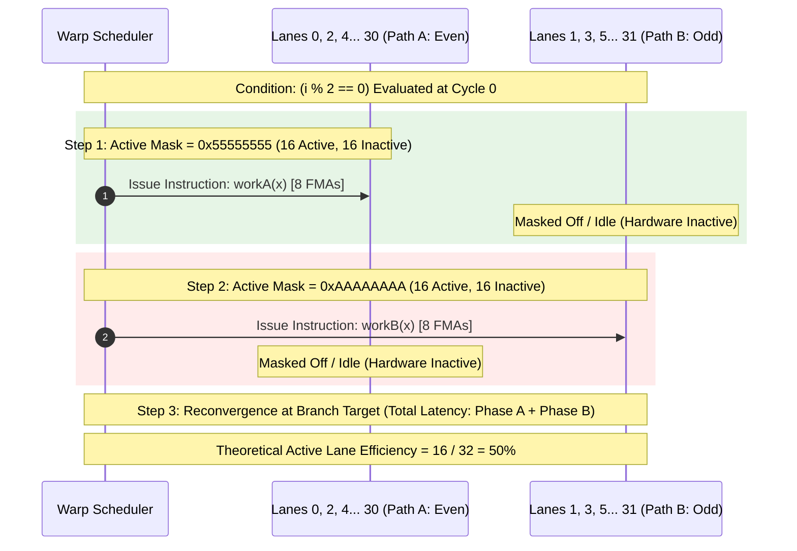
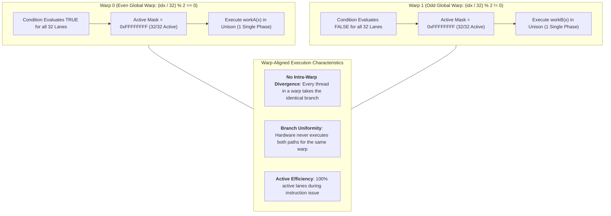
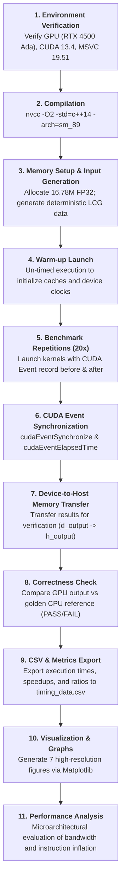
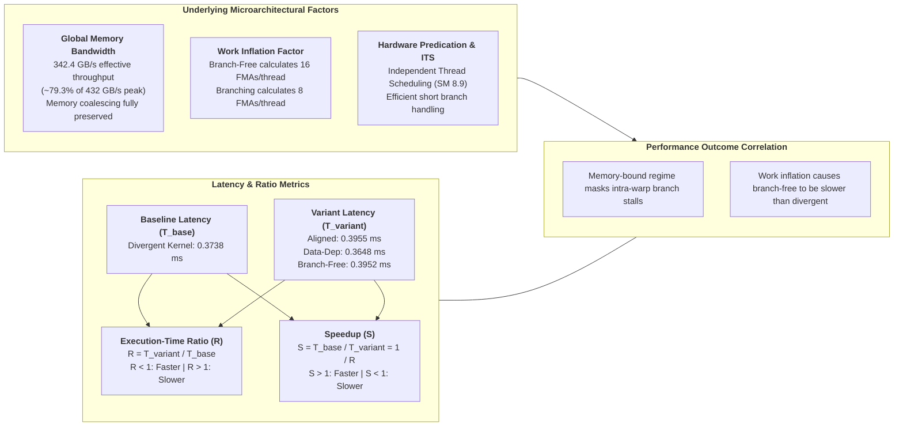

# Technical Diagrams Catalog: CUDA Warp Divergence Analysis

This directory contains formal architectural, SIMT execution, and microarchitectural analysis diagrams for **Lab Evaluation 2: CUDA Warp Divergence Analysis** on NVIDIA Ada Lovelace architecture (RTX 4500 Ada Generation, SM 8.9).

---

## Diagram 1 — Project Architecture

---

## Diagram 2 — CUDA Execution Hierarchy

---

## Diagram 3 — Warp Divergence (SIMT Execution Trace)

---

## Diagram 4 — Warp-Aligned Branching

---

## Diagram 5 — Four Kernel Strategies Comparison

```mermaid
classDiagram
    class DivergentKernel {
        Condition: (i % 2) == 0
        Branch Granularity: 1-thread alternation
        Warp Lane Behavior: 16 Lanes Path A, 16 Lanes Path B
        Active Mask: 0x55555555 then 0xAAAAAAAA
        Execution Phases: 2 Sequential Phases
        Estimated Lane Efficiency: ~50%
        Trade-off: Intra-warp serialization penalty
    }

    class WarpAlignedKernel {
        Condition: ((i / 32) % 2) == 0
        Branch Granularity: 32-thread chunk alignment
        Warp Lane Behavior: All 32 lanes take identical path
        Active Mask: 0xFFFFFFFF
        Execution Phases: 1 Unified Phase
        Estimated Lane Efficiency: 100%
        Trade-off: Zero intra-warp divergence; grid load balance
    }

    class DataDependentKernel {
        Condition: input[i] > threshold (0.5f)
        Branch Granularity: Stochastic / data-value dependent
        Warp Lane Behavior: Arbitrary split based on runtime input
        Active Mask: Dynamic non-uniform per warp
        Execution Phases: Up to 2 Phases per divergent warp
        Estimated Lane Efficiency: ~50% (stochastic average)
        Trade-off: Real-world workload behavior; requires data binning
    }

    class BranchFreeKernel {
        Condition: (input[i] > threshold) ? a : b
        Branch Granularity: No branching (predicated selp)
        Warp Lane Behavior: Both workA and workB computed unconditionally
        Active Mask: 0xFFFFFFFF (100% active)
        Execution Phases: 1 Phase computing 16 FMAs (both paths)
        Estimated Lane Efficiency: 100% (predicated)
        Trade-off: 2x arithmetic instructions (Work Inflation)
    }
```

---

## Diagram 6 — Benchmark Workflow

---

## Diagram 7 — Performance Analysis & Metric Correlation

